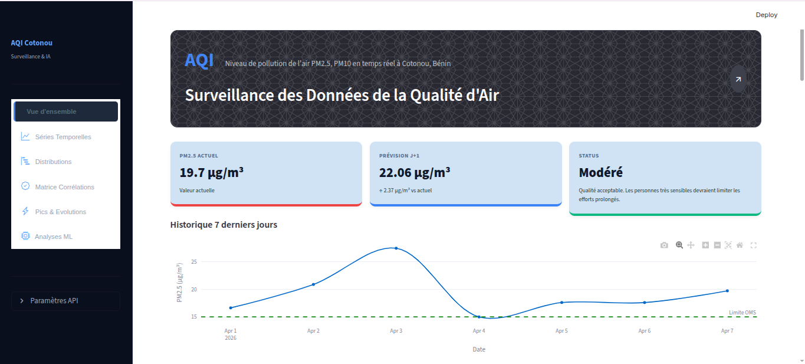
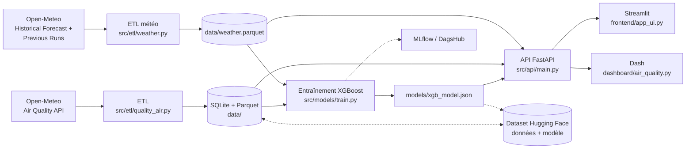

# Air Quality Cotonou — Prévision du PM2.5 à J+1

Prévoir la concentration moyenne de **particules fines PM2.5** du lendemain à **Cotonou (Littoral, Bénin)**, puis la traduire en niveau de qualité d'air et en conseil santé.



Le projet couvre toute la chaîne MLOps :
- **collecte** automatique des données ;
- **entraînement** suivi (MLflow / DagsHub) ;
- **API** de prévision (FastAPI) ;
- **interfaces** de visualisation (Streamlit et Dash) ;
- **monitoring** avec ré-entraînement conditionnel ;
- **déploiement** Docker / Hugging Face Spaces.

---

## Architecture



## Données

| Source | Contenu | Usage |
|---|---|---|
| [Open-Meteo Air Quality](https://open-meteo.com/en/docs/air-quality-api) (modèle CAMS global) | PM2.5, PM10, CO, CO₂, SO₂, O₃, NO₂, CH₄, AQI européen — horaire, depuis le 30/09/2025 | Cible + features |
| [Open-Meteo Historical Forecast](https://open-meteo.com/en/docs/historical-forecast-api) | Température, humidité, précipitations, vent, pression — y compris la prévision des jours à venir | Météo du jour J et prévision J+1 (inférence) |
| [Open-Meteo Previous Runs](https://open-meteo.com/en/docs/previous-runs-api) | Les mêmes variables, **telles que prévues la veille** | Prévision J+1 à l'entraînement |

> ⚠️ Les valeurs de qualité d'air sont des **sorties du modèle CAMS** (Copernicus), pas des mesures de capteurs au sol. Le modèle apprend donc à prévoir ce que CAMS indiquera le lendemain.

## Modèle

- **Cible** : variation du PM2.5 moyen entre aujourd'hui et demain, `pm2_5[J+1] − pm2_5[J]`. La prévision vaut `pm2_5[J] + variation prédite`.
- **Features** (47, définies dans [`src/models/features.py`](src/models/features.py), source unique pour l'entraînement, l'API et le monitoring) :
  - moyennes journalières des polluants, lags J-1 à J-3, moyenne glissante sur 7 jours, calendrier ;
  - dynamique en fin de journée : dernière heure, 6 dernières heures, maximum et écart-type du PM2.5 ;
  - météo du jour J, **météo prévue pour J+1** et évolution entre J et J+1 (vent u/v, humidité, pluie…).
- **Pas d'information du futur** : toutes les features de la ligne J sont connues au jour J. À l'entraînement, la météo de J+1 est la prévision **émise la veille**, ce qui reproduit l'échéance de production (environ 24-48 h).
- **Algorithme** : XGBoost, hyperparamètres dans [`params.yml`](params.yml).

### Performance

Erreur absolue moyenne (MAE) sur le PM2.5 du lendemain, comparée à la **persistance** (« demain = aujourd'hui ») :

| MAE (µg/m³) | Validation croisée temporelle (8 × 30 jours) | Test sept.–nov. 2026 |
|---|---|---|
| Persistance | 3,12 | 3,50 |
| **XGBoost** | **2,51 (−20 %)** | **2,78 (−21 %)** |

Les métriques du dernier entraînement sont écrites dans [`models/metrics.json`](models/metrics.json).

### Niveaux affichés

| PM2.5 prévu (µg/m³) | Niveau |
|---|---|
| ≤ 12 | Bon |
| ≤ 35 | Modéré |
| ≤ 55 | Mauvais |
| > 55 | Très Mauvais |

---

## Démarrage rapide

Toutes les commandes se lancent **depuis la racine du dépôt**.

```bash
# 1. Environnement
python -m venv .venv && source .venv/bin/activate
pip install -r requirements-dev.txt

# 2. Collecte (qualité d'air + météo) — incrémentale
python -c "from src.etl.quality_air import collect_and_refresh; collect_and_refresh()"

# 3. Entraînement (→ models/xgb_model.json, models/metrics.json)
python -m src.models.train --no-tracking --no-push

# 4. Prévision en ligne de commande
python -m src.models.inference

# 5. API  → http://localhost:7860/docs
uvicorn src.api.main:app --port 7860

# 6. Interface Streamlit (dans un autre terminal)
API_URL=http://localhost:7860 streamlit run frontend/app_ui.py
```

### Avec Docker

```bash
docker compose up --build
```

| Service | URL |
|---|---|
| API FastAPI | http://localhost:7860/docs |
| Frontend Streamlit | http://localhost:8501 |
| Dashboard Dash (EDA) | http://localhost:8050 |
| MLflow (optionnel : `docker compose --profile mlflow up`) | http://localhost:5000 |

Les ports se changent avec `API_PORT`, `UI_PORT` et `DASH_PORT`, par exemple `UI_PORT=8502 docker compose up`.

## API

| Méthode | Route | Description |
|---|---|---|
| GET | `/health` | État : modèle chargé, nombre de lignes, date de la dernière donnée |
| GET / POST | `/predict` | Prévision du PM2.5 de J+1, niveau et conseil |
| GET | `/history` | PM2.5 moyen des 7 derniers jours |
| GET | `/data?days=N` | Mesures horaires brutes, limitées aux N derniers jours si `days` est fourni |
| GET | `/monitoring?refresh=true` | Rapport qualité des données + performance récente |

Exemple de réponse de `/predict` :

```json
{
  "date_prevision": "2026-11-24",
  "current_pm25": 18.36,
  "predicted_pm25": 18.93,
  "delta": 0.57,
  "aqi_label": "Modéré",
  "conseil": "Qualité acceptable. Les personnes très sensibles devraient limiter les efforts prolongés.",
  "data_last_update": "2026-11-23T23:00:00+00:00",
  "model_source": "local:models/xgb_model.json"
}
```

## Configuration

Les variables peuvent être placées dans un fichier `.env`, qui n'est pas versionné.

| Variable | Défaut | Rôle |
|---|---|---|
| `HF_TOKEN` | — | Accès au dataset Hugging Face `donerick/air-quality-storage` (synchronisation des données, publication du modèle) |
| `DAGSHUB_TOKEN` / `MLFLOW_TRACKING_URI` | — | Active le suivi MLflow à l'entraînement |
| `MODEL_VERSION` | `latest` | `latest` : modèle local, sinon HF ; `<tag>` : `models/<tag>/` sur HF |
| `ENABLE_ETL_SCHEDULER` | `0` (`1` dans Docker) | L'API synchronise les données depuis HF puis collecte toutes les 12 h si la dernière collecte date de plus de 2 jours |
| `API_URL` | Space HF | URL de l'API utilisée par Streamlit et Dash |

## Automatisation et monitoring

- **Dans l'API** : avec `ENABLE_ETL_SCHEDULER=1`, collecte Open-Meteo puis publication des données sur Hugging Face.
- **Sur un serveur** : [`deploy.sh`](deploy.sh) lance l'API et l'UI, et installe un cron qui exécute [`job.sh`](job.sh) tous les 2 jours (collecte, puis ré-entraînement si nécessaire).
- **Monitoring** ([`src/models/monitoring.py`](src/models/monitoring.py)) :
  - contrôles de qualité (valeurs manquantes, valeurs aberrantes, données périmées) ;
  - backtest sur 7 jours ;
  - ré-entraînement déclenché par [`retrain_trigger.py`](src/models/retrain_trigger.py) si la MAE dépasse `max(1,5 × MAE de validation, 5 µg/m³)`.

## Structure du projet

```
├── src/
│   ├── etl/          quality_air.py (qualité d'air → SQLite/Parquet), weather.py (météo)
│   ├── models/       features.py, train.py, inference.py, registry.py, monitoring.py, retrain_trigger.py
│   └── api/          main.py (FastAPI), schemas.py, utils.py (lecture des données, synchro HF)
├── frontend/         app_ui.py — interface Streamlit
├── dashboard/        air_quality.py, dash_meteo.py — dashboards Dash (EDA)
├── data/             air_quality.db, air_quality.parquet, weather.parquet
├── models/           xgb_model.json, metrics.json, monitoring_report.json
├── notebook/         explorations et analyses
├── tests/            pytest (features, entraînement, API)
├── params.yml        hyperparamètres du modèle
├── Dockerfile, docker-compose.yml, deploy.sh, job.sh
```

## Tests

```bash
pytest tests
```

Les tests couvrent notamment :
- l'**absence de fuite d'information** (cible, features, météo J+1) ;
- l'aller-retour sauvegarde/chargement du modèle ;
- le contrat de l'API avec le frontend.

## Limites et pistes

- Les données de qualité d'air sont des sorties de modèle (CAMS). Les confronter à des **capteurs au sol** (par exemple OpenAQ) donnerait une mesure de précision réelle.
- La collecte enregistre les heures restantes de la journée en cours sous forme de prévisions CAMS, qui ne sont pas réécrites ensuite.
- Le pipeline DVC (`dvc.yml`) et la CI GitHub Actions restent à mettre à jour.

## Stack technique

Python 3.12+, Pandas, XGBoost, scikit-learn, FastAPI, Streamlit, Dash / Plotly, MLflow / DagsHub, Hugging Face Hub, APScheduler, Docker, pytest.

---

## Auteur

* ***Nom & Prénoms :*** **Eric KOULODJI**
* ***Profil :*** **Data Scientist, Machine Learning Engineer**

### **Founder of DTech-Africa**

*La Mathématique n'est pas un luxe, elle est la preuve vivante de notre existence sur Terre.*

### Contacts

* **LinkedIn :** https://www.linkedin.com/in/dona-erick
* **Facebook :** https://facebook.com/dona.eric.koulodji
* **Medium :** https://medium.com/@koulojiric
* **GitHub :** https://github.com/dona-eric

UNE SEULE ACTION :

***Abonnez-vous***

***Follow-me***

***Share***
